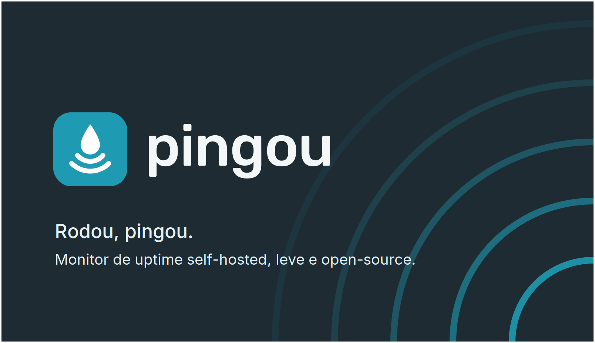

# 💧 Pingou

> **Rodou, pingou.** Monitor de uptime self-hosted, leve e open-source, escrito em Go.

O Pingou verifica se seus serviços estão no ar, guarda o histórico em SQLite, abre e fecha incidentes quando o estado muda e avisa por webhook. Tudo em **um binário só**, com o dashboard web embutido.

O projeto tem quatro objetivos:

- **simples de rodar**: um binário ou um container, sem banco separado
- **simples de manter**: SQLite em arquivo, sem serviços extras
- **leve**: roda numa VPS mínima ou num Raspberry Pi
- **focado**: faz uma coisa só (dizer se algo está no ar) e faz bem

---

## Tipos de monitor

| Tipo        | O que verifica                                  | Direção          | Status     |
| ----------- | ----------------------------------------------- | ---------------- | ---------- |
| `http`      | Uma URL responde com sucesso                    | Pingou → serviço | Disponível |
| `tcp`       | Uma porta aceita conexões                       | Pingou → serviço | Disponível |
| `heartbeat` | Um serviço avisou que está vivo dentro do prazo | Serviço → Pingou | Disponível |

Os três tipos usam os mesmos estados (`UNKNOWN`, `UP`, `DOWN`), o mesmo registro de incidentes e o mesmo webhook. Só muda **como** o check é feito.

### HTTP

Faz uma requisição para a URL configurada. Considera `UP` quando a resposta chega dentro do timeout com status de sucesso; caso contrário, registra o erro em `last_error`.

- Segue até `PINGOU_MAX_REDIRECTS` redirects.
- Vira `DOWN` depois de `threshold` falhas seguidas.

### TCP

Tenta abrir uma conexão TCP com `host:porta`. Útil para bancos de dados, filas, SMTP, SSH e qualquer serviço que não fala HTTP.

- `UP`: a conexão abriu dentro do timeout.
- `DOWN`: conexão recusada, timeout ou host inexistente (o motivo vai para `last_error`).
- O tempo de resposta registrado é o tempo para conectar.
- Vira `DOWN` depois de `threshold` falhas seguidas, igual ao HTTP.

### Heartbeat

O inverso dos outros tipos: **o serviço pinga o Pingou**. Ideal para cron jobs, backups, workers e qualquer tarefa que roda em horário marcado.

Como funciona:

1. Ao criar o monitor, o Pingou gera um **token secreto** e uma URL de ping, por exemplo `https://seu-pingou/ping/<token>`.
2. A tarefa chama essa URL quando termina com sucesso.
3. Cada chamada registra um check `UP`.
4. Se passar do **intervalo + tolerância** sem nenhuma chamada, o monitor vira `DOWN`.
5. Antes da primeira chamada, o monitor fica `UNKNOWN`.

Regras:

- `interval_seconds` é o período esperado entre pings (ex.: `86400` para uma tarefa diária), de 1 minuto a 1 semana.
- `grace_seconds` é a tolerância para atrasos. Padrão: `60`.
- O `threshold` **não se aplica**: perdeu o prazo + tolerância, vira `DOWN`. A tolerância já cumpre esse papel.
- O `timeout` também não se aplica.
- Monitor pausado aceita o ping, mas não registra nada. Ao retomar, o prazo recomeça a contar a partir da retomada (os pings da pausa não foram registrados).
- O avaliador de prazos roda a cada 10 segundos e gera **um** check `DOWN` por queda, não um por rodada.
- A URL de ping fica sempre visível no dashboard e pode ser **regenerada** a qualquer momento (o token antigo deixa de funcionar na hora).

Exemplo com cron:

```bash
# Backup todo dia às 3h. Só avisa o Pingou se o backup terminar com sucesso.
0 3 * * * /usr/local/bin/backup.sh && curl -fsS -m 10 --retry 3 https://pingou.exemplo.com/ping/SEU_TOKEN > /dev/null
```

> **Importante:** para receber pings de outras máquinas, a rota `/ping/*` precisa estar acessível a partir delas.

### Princípio de escopo

Um novo tipo de check só entra no Pingou se passar nas quatro perguntas:

1. Responde só `UP` ou `DOWN`, sem estados novos?
2. Funciona com a biblioteca padrão do Go, sem dependência pesada?
3. Dispensa agente instalado no servidor monitorado?
4. Roda sem permissões especiais (root, capabilities, socket do Docker)?

É por isso que, por enquanto, ficam de fora: ping ICMP (exige permissão especial), métricas de CPU/memória/disco (exigem agente) e monitoramento de Docker (exige o socket do Docker).

---

## Funcionalidades

- Monitores dos tipos HTTP, TCP e Heartbeat
- Intervalo, timeout e threshold configuráveis por monitor
- Detecção de transições de estado:
  - `UNKNOWN → UP`
  - `UNKNOWN → DOWN`
  - `UP → DOWN`
  - `DOWN → UP`
- Registro de incidentes abertos e resolvidos
- Dashboard web embutido no binário
- Página de detalhe por monitor (`/monitors/:id`): uptime, resposta média, incidentes e tempo fora do ar em 24h / 7 / 14 / 30 dias, gráfico de tempo de resposta, últimos checks e configuração
- Login com API Key
- Webhook global para quedas e recuperações
- Retenção configurável: checks e incidentes resolvidos expiram após `retention_days` (incidentes abertos nunca). A limpeza roda na subida e a cada 1 h
- Export do banco SQLite
- Atomicidade na state machine (transações SQL)

## Stack

### Backend

- Go
- `net/http`
- SQLite (`github.com/mattn/go-sqlite3`)
- `goose` para migrations
- `log/slog`

### Frontend

- React
- Vite
- React Router
- Axios
- Tailwind CSS

### Infra

- Docker e Docker Compose
- `embed.FS` para embutir os assets do frontend no binário

---

## Arquitetura

### Checkers

Cada tipo de monitor é implementado por um **checker**: um arquivo que cumpre uma interface pequena.

```go
type Checker interface {
    Check(ctx context.Context, m *domain.Monitor) CheckResult
}
```

O `checker.Registry` escolhe o checker pelo campo `type` do monitor e o agendador entrega o `CheckResult` para a state machine. A state machine **não conhece o tipo do check**: ela só recebe "deu certo" ou "deu errado". Por isso, adicionar um tipo novo não mexe em incidentes, transações nem webhook.

O Heartbeat é o único caso diferente:

- Os checks `UP` chegam pela rota pública `/ping/{token}`.
- Um avaliador periódico verifica prazos vencidos e gera os checks `DOWN`.
- Os dois caminhos passam pela mesma state machine.

### Transações (Unit of Work)

O processamento da state machine é **atômico**, usando o padrão Unit of Work.

**O problema:** `StateMachine.Process` executava operações em sequência (inserir check, atualizar monitor, abrir incidente, fechar incidente). Se uma etapa falhasse depois de outra já gravada, o banco ficava parcialmente atualizado.

**A solução:** todas as operações rodam na mesma transação SQL.

```
┌─────────────────────────────────────────────────────────────┐
│                     StateMachine.Process                    │
├─────────────────────────────────────────────────────────────┤
│  1. uow.Begin()                     → inicia transação      │
│  2. checkRepo.CreateWithTx()        → insere check          │
│  3. monitorRepo.UpdateWithTx()      → atualiza monitor      │
│  4. incidentRepo.CreateWithTx()     → abre incidente        │
│  5. incidentRepo.Close()            → fecha incidente       │
│  6. uow.Commit()                    → confirma transação    │
│  7. notifier.NotifyDown/Recovery()  → webhook (APÓS commit) │
└─────────────────────────────────────────────────────────────┘
```

Garantias:

- **Atomicidade**: check, mudança de estado e incidente são gravados juntos.
- **Rollback automático**: em caso de erro, nada é gravado.
- **Webhook seguro**: as notificações só saem depois do commit.

| Componente         | Arquivo                                   | Descrição                  |
| ------------------ | ----------------------------------------- | -------------------------- |
| `UnitOfWork`       | `internal/service/unit_of_work.go`        | Interface de transações    |
| `sqliteUnitOfWork` | `internal/service/unit_of_work_impl.go`   | Implementação com `sql.Tx` |
| `CheckRepoTx`      | `internal/repository/check_repo_tx.go`    | Checks com suporte a Tx    |
| `MonitorRepoTx`    | `internal/repository/monitor_repo_tx.go`  | Monitors com suporte a Tx  |
| `IncidentRepoTx`   | `internal/repository/incident_repo_tx.go` | Incidents com suporte a Tx |

### Modelo de dados do monitor

Os monitores ganham três campos:

| Campo        | Descrição                                                                    |
| ------------ | ---------------------------------------------------------------------------- |
| `type`       | `http`, `tcp` ou `heartbeat`. Padrão `http`: monitores existentes não mudam. |
| `config`     | JSON com os campos específicos do tipo.                                      |
| `ping_token` | Token secreto da URL de ping (somente `heartbeat`).                          |

Campos de `config` por tipo:

| Tipo        | Campos                             |
| ----------- | ---------------------------------- |
| `http`      | (usa o campo `url` do monitor)     |
| `tcp`       | `host` (texto), `port` (1 a 65535) |
| `heartbeat` | `grace_seconds` (padrão `60`)      |

---

## Estrutura do projeto

```text
pingou/
├── cmd/
│   └── pingou/
│       └── main.go
├── internal/
│   ├── config/
│   ├── database/
│   ├── domain/
│   ├── repository/
│   ├── service/
│   ├── handler/
│   └── checker/        # um arquivo por tipo de check
├── migrations/
├── web/
│   ├── src/
│   │   ├── api/
│   │   ├── components/
│   │   ├── hooks/
│   │   ├── pages/
│   │   ├── main.jsx
│   │   └── theme/
│   ├── package.json
│   └── vite.config.js
├── assets/             # marca, favicons e grafismos
├── docs/               # manual de identidade visual
├── bin/
├── DESIGN.md           # design system
├── Dockerfile
├── docker-compose.yml
├── Makefile
├── .env.example
├── .editorconfig
├── go.mod
└── README.md
```

---

## Como rodar em desenvolvimento

### Requisitos

- Go
- Node.js + npm
- GCC ou toolchain compatível com CGO
- SQLite
- `gofumpt` (para o target `fmt`)

### 1. Configurar o ambiente

Crie um arquivo `.env` na raiz, com base no `.env.example`:

```env
PINGOU_PORT=8080
PINGOU_DATABASE_URL=./pingou.db
PINGOU_API_KEY=dev-api-key
PINGOU_LOG_LEVEL=info
PINGOU_CORS_ALLOWED_ORIGINS=
```

### 2. Rodar a aplicação

```bash
make dev
```

Esse comando formata o código Go e sobe o backend com as variáveis do `.env`.

### 3. Build do frontend

```bash
make build-web
```

### 4. Build completo

```bash
make build
```

O binário é gerado em `bin/pingou`.

Ainda não há workflow de GitHub Actions. Também não há suíte de testes automatizados no primeiro momento; a validação do projeto é local e manual, via `make build` e `make docker-build` quando necessário.

### Convenções de formatação

O `.editorconfig` na raiz padroniza:

- UTF-8, line endings LF e newline final
- remoção de espaços finais
- tabs para Go e Makefile
- 2 espaços para JS, JSX, JSON, CSS, Markdown, YAML, SQL, Dockerfile e `.env*`

Ele complementa o `gofumpt` no backend e o ESLint/Vite no frontend.

---

## Como rodar com Docker

O Dockerfile inclui um `HEALTHCHECK` que consulta o endpoint público `/healthz` a cada 30 segundos.

```bash
make docker-build   # build da imagem
make docker-up      # sobe com Docker Compose
docker ps           # a coluna STATUS deve mostrar "healthy"
make docker-down    # derruba os containers
```

---

## Login no dashboard

O dashboard pede uma **API Key**. Ela é validada contra a API e guardada no `localStorage` do navegador. Use o mesmo valor de:

```env
PINGOU_API_KEY=...
```

## Variáveis de ambiente

| Variável                      | Obrigatória | Padrão      | Descrição                                                                                             |
| ----------------------------- | :---------: | ----------- | ----------------------------------------------------------------------------------------------------- |
| `PINGOU_PORT`                 |     não     | `8080`      | Porta HTTP da aplicação                                                                               |
| `PINGOU_DATABASE_URL`         |     não     | `pingou.db` | Caminho do arquivo SQLite                                                                             |
| `PINGOU_API_KEY`              |     sim     | -           | Chave que protege o dashboard e as rotas `/api/*`                                                     |
| `PINGOU_LOG_LEVEL`            |     não     | `info`      | Nível de log (`DEBUG` habilita logs de debug)                                                         |
| `PINGOU_CORS_ALLOWED_ORIGINS` |     não     | (vazio)     | Origins permitidas, separadas por vírgula. Vazio desabilita CORS. Ex.: `http://localhost:5173`        |
| `PINGOU_MAX_REDIRECTS`        |     não     | `5`         | Máximo de redirects seguidos pelo checker HTTP                                                        |
| `PINGOU_GLOBAL_TIMEOUT`       |     não     | `60`        | Timeout global, em segundos, das requisições HTTP                                                     |
| `PINGOU_PUBLIC_URL`           |     não     | (vazio)     | Endereço público do dashboard. Preenche `dashboard_url` no webhook. Ex.: `https://pingou.exemplo.com` |

## SQLite

O backend abre o SQLite com:

- `_foreign_keys=on`
- `_journal_mode=WAL`
- `_busy_timeout=5000`
- `SetMaxOpenConns(1)`

Se `PINGOU_DATABASE_URL` já tiver query params, eles são preservados e os parâmetros acima são aplicados pelo app.

---

## Autenticação da API

As rotas protegidas exigem o header:

```http
X-API-Key: sua-chave
```

```bash
curl -H "X-API-Key: dev-api-key" http://localhost:8080/api/monitors
```

A rota de ping do Heartbeat (`/ping/{token}`) é a exceção: ela é pública, porque o próprio token é o segredo.

## Middlewares HTTP

### Recover

Captura `panic` nos handlers, registra no log com `request_id` e stack trace, e responde `500` com mensagem genérica:

```json
{
  "error": "internal server error",
  "code": "INTERNAL_ERROR"
}
```

### CORS

Controlado por `PINGOU_CORS_ALLOWED_ORIGINS`. Se vazio (padrão), nenhum cabeçalho CORS é adicionado. Para desenvolvimento com Vite:

```env
PINGOU_CORS_ALLOWED_ORIGINS=http://localhost:5173
```

O middleware responde ao preflight `OPTIONS`, permite o header `X-API-Key` e valida a origem contra a lista.

### Limite de requisições na rota de ping

Como `/ping/{token}` é pública, ela tem limite de **60 requisições por minuto por IP** (janela fixa, em memória). Acima disso, responde `429` com o header `Retry-After`. Tokens inválidos também contam, o que dificulta tentar adivinhar tokens.

- O IP considerado é o da conexão (`RemoteAddr`). Atrás de um proxy reverso, todos os clientes aparecem com o IP do proxy e dividem o mesmo limite. Suporte a `X-Forwarded-For` fica para uma versão futura.
- O caminho `/ping/<token>` aparece como `/ping/[redacted]` nos logs: o token é um segredo.

---

## Endpoints

### Públicos

| Método              | Rota            | Descrição                             |
| ------------------- | --------------- | ------------------------------------- |
| `GET`               | `/healthz`      | Status básico da aplicação            |
| `GET` `POST` `HEAD` | `/ping/{token}` | Recebe o ping de um monitor Heartbeat |

Sobre `/ping/{token}`:

- Responde `200` quando o token é válido (mesmo com o monitor pausado).
- Responde `404` quando o token não existe, sem revelar detalhes.
- O corpo da requisição é ignorado.

### Protegidos

| Método   | Rota                          | Descrição                                                       |
| -------- | ----------------------------- | --------------------------------------------------------------- |
| `GET`    | `/api/monitors`               | Lista os monitores                                              |
| `POST`   | `/api/monitors`               | Cria um monitor                                                 |
| `GET`    | `/api/monitors/:id`           | Busca um monitor                                                |
| `PATCH`  | `/api/monitors/:id`           | Atualiza um monitor                                             |
| `DELETE` | `/api/monitors/:id`           | Remove um monitor                                               |
| `POST`   | `/api/monitors/:id/token`     | Gera um novo token de ping (Heartbeat)                          |
| `GET`    | `/api/monitors/:id/checks`    | Histórico de checks, paginado (`limit`, `offset`)               |
| `GET`    | `/api/monitors/:id/incidents` | Incidentes do monitor (mesmos filtros de `/api/incidents`)      |
| `GET`    | `/api/monitors/:id/stats`     | Estatísticas numa janela (`range=24h\|7d\|14d\|30d`)            |
| `GET`    | `/api/incidents`              | Lista incidentes (`status`, `monitor_id`, `limit`, `offset`)    |
| `GET`    | `/api/settings`               | Busca as configurações globais                                  |
| `PATCH`  | `/api/settings`               | Atualiza as configurações globais (`webhook_url` só http/https) |
| `POST`   | `/api/settings/webhook/test`  | Envia um evento `test` ao webhook (5 por minuto por IP)         |
| `GET`    | `/api/info`                   | Versão, commit, data do build e tamanho do banco                |
| `GET`    | `/api/export`                 | Baixa um dump do SQLite (`pingou-AAAA-MM-DD.db`, `VACUUM INTO`) |

### Info

```bash
curl -H "X-API-Key: dev-api-key" http://localhost:8080/api/info
```

```json
{
  "version": "v1.0",
  "commit": "abc1234",
  "build_date": "2026-10-29T12:00:00Z",
  "database_size_bytes": 13002342
}
```

`database_size_bytes` soma o arquivo do banco com o `-wal` e o `-shm`. O backup sai um pouco menor.

### Listando incidentes

`GET /api/incidents` aceita:

- `status=open|resolved` (vazio = todos; `open=true` continua aceito como `status=open`; outro valor → `400`)
- `monitor_id=<id>`
- `limit` (padrão 20, máximo 100) e `offset`

Abertos vêm por `started_at` decrescente; resolvidos, por `ended_at` decrescente. `total` é a contagem real do filtro, independente de `limit`.

```bash
curl -H "X-API-Key: dev-api-key" "http://localhost:8080/api/incidents?status=open&limit=1"
```

Cada item traz o monitor e a contagem de falhas:

```json
{
  "id": "0192…",
  "monitor_id": "0191…",
  "monitor": {
    "id": "0191…",
    "name": "API",
    "type": "http",
    "target": "https://api.exemplo.com/health"
  },
  "started_at": "2026-10-27T14:43:00Z",
  "ended_at": null,
  "last_error": "dial tcp 10.0.0.5:443: connect: connection refused",
  "failure_count": 42,
  "duration_seconds": 3600,
  "notification_sent": true,
  "open": true
}
```

`target` é a URL (http), `host:porta` (tcp) ou `null` (heartbeat). `last_error` é o erro que abriu o incidente; `failure_count` soma os checks com falha enquanto ele esteve aberto.

### Estatísticas de um monitor

`GET /api/monitors/:id/stats?range=24h` resume o monitor numa janela. `range` aceita `24h` (padrão), `7d`, `14d` e `30d`; outro valor → `400`.

| `range` | Balde  | Pontos em `series` |
| ------- | ------ | ------------------ |
| `24h`   | 10 min | 144                |
| `7d`    | 1 h    | 168                |
| `14d`   | 3 h    | 112                |
| `30d`   | 6 h    | 120                |

```bash
curl -H "X-API-Key: dev-api-key" "http://localhost:8080/api/monitors/<id>/stats?range=7d"
```

```json
{
  "range": "24h",
  "since": "2026-10-28T14:10:00Z",
  "until": "2026-10-29T14:10:00Z",
  "bucket_seconds": 600,
  "uptime": 99.93,
  "avg_latency_ms": 214,
  "checks": 1440,
  "incidents": 1,
  "downtime_seconds": 60,
  "series": [
    {
      "t": "2026-10-28T14:10:00Z",
      "avg_latency_ms": 203,
      "checks": 10,
      "failures": 0
    }
  ],
  "down": [{ "start": "2026-10-29T10:12:00Z", "end": "2026-10-29T10:13:00Z" }]
}
```

- `since` e `until` ficam alinhados ao balde; o último balde é o corrente (parcial). `series` sempre tem o mesmo tamanho, com baldes vazios incluídos.
- `avg_latency_ms` (total e por balde) usa só checks com sucesso; `null` quando não há nenhum. `uptime` é `null` sem checks na janela.
- `down` são os incidentes que se sobrepõem à janela, recortados a ela; um incidente aberto termina no momento da consulta. `incidents` é o tamanho de `down` e `downtime_seconds` a soma das durações.
- A API aceita qualquer dos 4 períodos; a tela desabilita os maiores que `retention_days`, já que não há dados para eles.

### Criando monitores de cada tipo

HTTP:

```bash
curl -X POST http://localhost:8080/api/monitors \
  -H "X-API-Key: dev-api-key" -H "Content-Type: application/json" \
  -d '{"name":"API","type":"http","url":"https://api.exemplo.com/health","interval_seconds":60,"timeout_seconds":5,"failure_threshold":3}'
```

TCP:

```bash
curl -X POST http://localhost:8080/api/monitors \
  -H "X-API-Key: dev-api-key" -H "Content-Type: application/json" \
  -d '{"name":"Postgres","type":"tcp","config":{"host":"db.interno","port":5432},"interval_seconds":60,"timeout_seconds":5,"failure_threshold":3}'
```

Heartbeat:

```bash
curl -X POST http://localhost:8080/api/monitors \
  -H "X-API-Key: dev-api-key" -H "Content-Type: application/json" \
  -d '{"name":"Backup diário","type":"heartbeat","interval_seconds":86400,"config":{"grace_seconds":3600}}'
```

A resposta do Heartbeat inclui o `ping_token` para montar a URL de ping.

> Se `type` não for enviado, o monitor é criado como `http`. Se `enabled` não for enviado, o monitor é criado ativo.

Limites de `interval_seconds`: 10 a 86400 para `http` e `tcp`; 60 a 604800 (1 semana) para `heartbeat`.

`GET /api/monitors` também traz, por monitor, o resumo usado pelo painel: `history` (últimos 30 checks, `true` = sucesso, mais recente por último), `uptime_24h` (percentual, `null` sem checks) e `last_latency_ms`.

---

## Webhook

Quando `webhook_url` está configurado em settings, o Pingou envia um `POST` JSON a cada transição para `DOWN` ou de volta para `UP`.

Evento de queda:

```json
{
  "event": "down",
  "monitor": {
    "id": "018f2f7a-...",
    "name": "API",
    "type": "http",
    "target": "https://api.exemplo.com/health",
    "url": "https://api.exemplo.com/health"
  },
  "timestamp": "2026-05-01T12:00:00Z",
  "last_error": "unexpected status code: 500",
  "downtime_duration_seconds": null,
  "dashboard_url": "https://pingou.exemplo.com/monitors/018f2f7a-..."
}
```

Evento de recuperação:

```json
{
  "event": "up",
  "monitor": {
    "id": "018f2f7a-...",
    "name": "API",
    "type": "http",
    "target": "https://api.exemplo.com/health",
    "url": "https://api.exemplo.com/health"
  },
  "timestamp": "2026-05-01T12:05:00Z",
  "last_error": null,
  "downtime_duration_seconds": 300,
  "dashboard_url": "https://pingou.exemplo.com/monitors/018f2f7a-..."
}
```

Campos `type` e `target`:

| Tipo        | `target`     | `url`                                |
| ----------- | ------------ | ------------------------------------ |
| `http`      | a URL        | a URL (mantido para compatibilidade) |
| `tcp`       | `host:porta` | `null`                               |
| `heartbeat` | `null`       | `null`                               |

`dashboard_url` leva à página de detalhe do monitor. É `null` sem `PINGOU_PUBLIC_URL` (o Pingou não sabe o próprio endereço público) e no evento `test`.

> A URL de ping do Heartbeat **nunca** é enviada no webhook, porque ela contém o token secreto e webhooks costumam ir para serviços de terceiros (Slack, Discord etc.).

### Testando o webhook

`POST /api/settings/webhook/test` envia um evento `test` sem gravar nada no banco. Com `{"url": "..."}` no corpo, testa essa URL (sem salvar). Sem corpo, testa a URL salva.

```bash
curl -X POST http://localhost:8080/api/settings/webhook/test \
  -H "X-API-Key: dev-api-key" \
  -d '{"url":"https://webhook.site/<id>"}'
```

```json
{
  "ok": false,
  "status_code": 404,
  "duration_ms": 142,
  "error": "unexpected status code: 404"
}
```

- A resposta é sempre `200` quando o teste roda. `ok` diz se o destino respondeu 2xx.
- `status_code` é `null` quando não houve resposta (ex.: `"error": "timeout após 5s"`).
- Timeout de 5 s, redirects **não** são seguidos e o corpo do destino nunca é devolvido.
- `400` sem URL (nem no corpo, nem salva) ou com esquema que não seja http/https. `429` com `Retry-After` depois de 5 testes por minuto.

O payload tem o mesmo formato dos eventos reais:

```json
{
  "event": "test",
  "monitor": {
    "id": "00000000-0000-0000-0000-000000000000",
    "name": "Teste do Pingou",
    "type": "http",
    "target": "https://exemplo.com",
    "url": "https://exemplo.com"
  },
  "timestamp": "2026-10-29T12:00:00Z",
  "last_error": null,
  "downtime_duration_seconds": null,
  "dashboard_url": null
}
```

> Integrações que tratam `event` devem **ignorar valores desconhecidos**. Novos eventos podem surgir sem aviso.

---

## Comandos do Makefile

| Comando                    | Descrição                                                                |
| -------------------------- | ------------------------------------------------------------------------ |
| `make start`               | Compila e executa o binário com as variáveis do `.env`                   |
| `make dev`                 | Roda em modo desenvolvimento com as variáveis do `.env`                  |
| `make fmt`                 | Formata o código Go com `gofumpt`                                        |
| `make build`               | Compila frontend e binário Go (`CGO_ENABLED=1`). Gera `bin/pingou`       |
| `make test`                | Executa os testes Go do módulo                                           |
| `make clean`               | Remove artefatos locais, como `bin/`                                     |
| `make build-web`           | Instala dependências do frontend e gera o bundle com Vite                |
| `make docker-build`        | Constrói a imagem multi-stage, com tags `$(VERSION)` e `latest`          |
| `make docker-up`           | Sobe os serviços com `docker compose up --build`                         |
| `make docker-down`         | Derruba os serviços do Compose                                           |
| `make docker-size`         | Mede o tamanho da imagem (requisito do PRD) e remove a imagem temporária |
| `make docker-startup-test` | Mede o tempo de startup do Compose; sucesso se < 30s                     |
| `make release`             | Gera o build final em `bin/pingou`                                       |

Alguns targets são encadeados. Por exemplo, `build` roda `build-web` antes de compilar o binário.

---

## CLI

O binário inclui comandos para operar o banco e depurar sem passar pela API.

### Instalação

```bash
make build
# ou
go build -o pingou ./cmd/pingou
```

### Comandos

| Comando                 | Descrição                                       |
| ----------------------- | ----------------------------------------------- |
| `pingou serve`          | Inicia a API + dashboard (comportamento padrão) |
| `pingou add`            | Cria um monitor                                 |
| `pingou rm`             | Remove um monitor pelo ID                       |
| `pingou migrate up`     | Executa migrations pendentes                    |
| `pingou migrate down`   | Reverte a última migration                      |
| `pingou migrate status` | Mostra o status das migrations                  |
| `pingou export-db`      | Exporta o banco SQLite                          |
| `pingou version`        | Mostra a versão do binário                      |
| `pingou config`         | Mostra a configuração atual (sem secrets)       |

### serve

```bash
./pingou serve
PINGOU_PORT=9999 ./pingou serve
```

**Proteção contra múltiplas instâncias:** usa um lock file em `~/.pingou/pingou.lock`. Se já houver um servidor rodando, retorna erro.

### add

```bash
# HTTP
./pingou add -n "API" -u "https://api.exemplo.com/health" -i 30 -t 10 -K 5 --key <API_KEY>

# TCP
./pingou add -n "Postgres" --type tcp --host db.interno --port 5432 --key <API_KEY>

# Heartbeat
./pingou add -n "Backup diário" --type heartbeat -i 86400 --grace 3600 --key <API_KEY>
```

| Flag          | Abrev | Padrão        | Descrição                                                     |
| ------------- | ----- | ------------- | ------------------------------------------------------------- |
| `--name`      | `-n`  | (obrigatório) | Nome do monitor                                               |
| `--type`      |       | `http`        | `http`, `tcp` ou `heartbeat`                                  |
| `--url`       | `-u`  |               | URL a verificar (obrigatório para `http`)                     |
| `--host`      |       |               | Host (obrigatório para `tcp`)                                 |
| `--port`      |       |               | Porta (obrigatório para `tcp`)                                |
| `--grace`     |       | `60`          | Tolerância em segundos (`heartbeat`)                          |
| `--interval`  | `-i`  | `60`          | Intervalo em segundos                                         |
| `--timeout`   | `-t`  | `5`           | Timeout em segundos (não se aplica a `heartbeat`)             |
| `--threshold` | `-K`  | `3`           | Falhas seguidas antes de `DOWN` (não se aplica a `heartbeat`) |

O monitor é sempre criado com `enabled: true`. Para `heartbeat`, o comando imprime a URL de ping.

### rm

```bash
./pingou rm --id 019def55-0c92-76a5-a7c4-b573ab447ac2 --key <API_KEY>
```

| Flag   | Abrev | Padrão        | Descrição     |
| ------ | ----- | ------------- | ------------- |
| `--id` | `-i`  | (obrigatório) | ID do monitor |

### migrate

```bash
./pingou migrate up --key <API_KEY>
./pingou migrate down --key <API_KEY>
./pingou migrate status --key <API_KEY>
```

> Requer `--key` igual ao `PINGOU_API_KEY` do `.env`.

### export-db

```bash
# Sem argumento: cria exported_<banco>.db no diretório atual
./pingou export-db --key <API_KEY>

# Com caminho de saída
./pingou export-db -o /tmp/backup.db --key <API_KEY>
```

> O export inclui os tokens de ping dos monitores Heartbeat. Guarde o arquivo com o mesmo cuidado que a API Key.

### version

```bash
./pingou version
# pingou dev
# commit: none
# build date: unknown
```

### config

```bash
./pingou config --key <API_KEY>
# {
#   "DatabaseURL": "./pingou.db",
#   "Port": "8080",
#   "LogLevel": "debug",
#   "CORSAllowedOrigins": null,
#   "MaxRedirects": 5,
#   "GlobalTimeout": 60
# }
```

### Flags globais

| Flag              | Descrição                                                           |
| ----------------- | ------------------------------------------------------------------- |
| `--key`           | API Key para comandos protegidos (`migrate`, `export-db`, `config`) |
| `-v`, `--verbose` | Modo verboso                                                        |

### Exit codes

- `0`: sucesso
- `1`: erro

---

## Release

```bash
make release
```

Gera o build final em `bin/pingou`.

---

## Objetivos do projeto

- ser um monitor de uptime simples
- rodar com poucos recursos
- usar SQLite para reduzir a complexidade operacional
- embutir o frontend no backend
- funcionar bem como projeto real e como estudo de Go

A ideia não é competir com ferramentas enterprise nem com plataformas completas de observabilidade. É entregar um monitor funcional, leve e fácil de entender.

## Roadmap

### Próxima versão

- [x] Interface `Checker` (refatoração, sem mudança de comportamento)
- [x] Monitor TCP
- [x] Monitor Heartbeat
- [x] Redesign do dashboard com a nova identidade visual (tema claro)

### Depois

- Verificação de palavra-chave na resposta HTTP
- Monitor DNS
- Aviso de expiração de certificado SSL (via webhook, sem estado novo)
- Ping ICMP (depende de resolver as permissões sem complicar a instalação)
- Tema escuro
- Status page pública
- Métricas e gráficos
- Integração com Prometheus
- Webhook por monitor
- Templates para Discord e Slack
- Multi-tenancy

---

## Identidade visual

A marca, as cores, a tipografia e os grafismos do Pingou estão documentados em:

- [`DESIGN.md`](DESIGN.md): design system resumido (tokens, tipografia, componentes). Fonte da verdade para UI, README e assets.
- [`docs/pingou-manual-identidade-visual.pdf`](docs/pingou-manual-identidade-visual.pdf): manual de identidade visual completo.
- [`assets/`](assets/): marca, símbolos, favicons e grafismos oficiais em SVG e PNG.

## Licença

Apache 2.0
